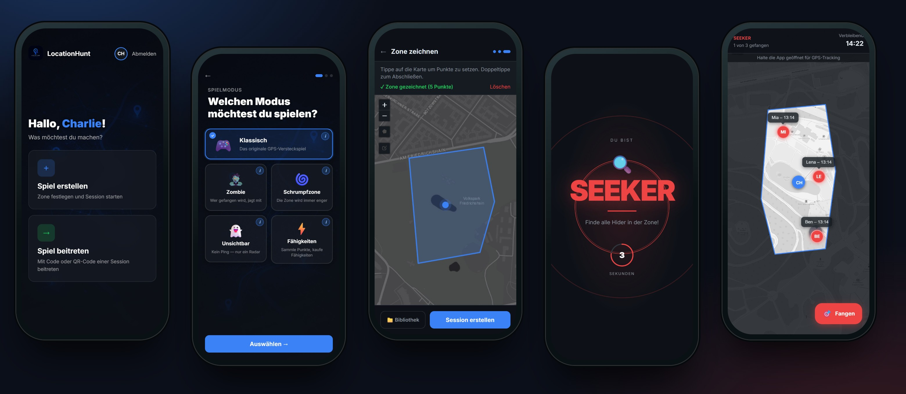
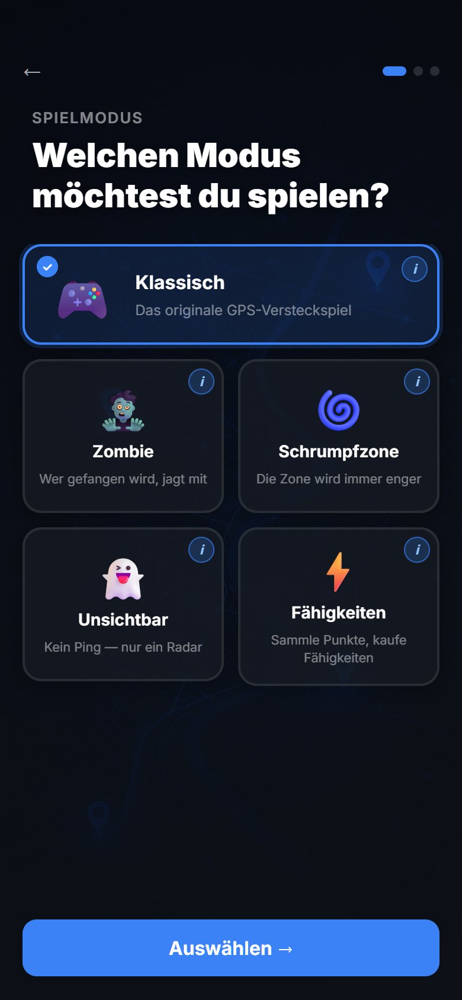
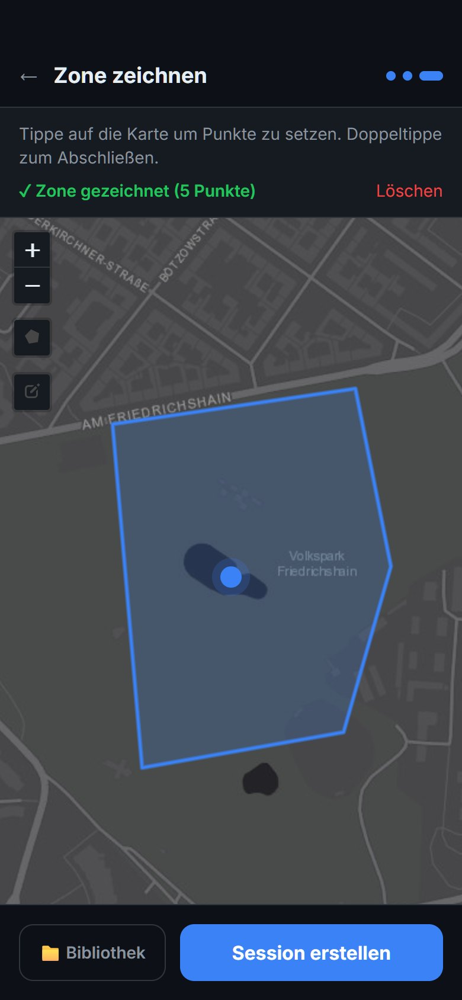
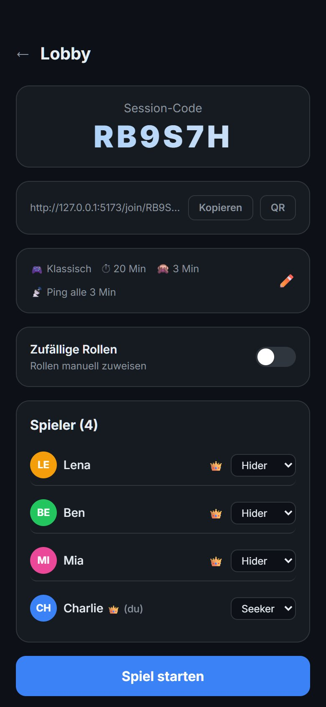
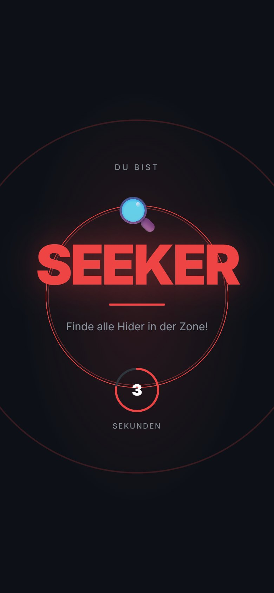
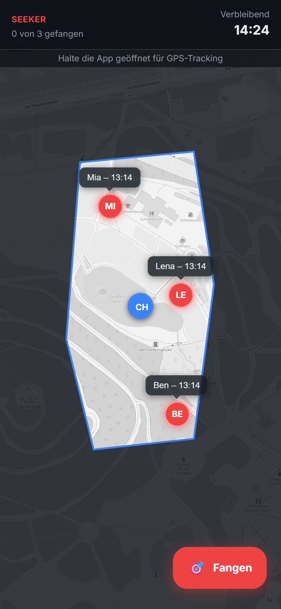

<div align="center">


# LocationHunt

**GPS-Verstecken für draußen.**<br>
Zone zeichnen, Freunde einladen, verstecken und jagen, live auf der Karte.

<br>

<a href="https://location-hunt.vercel.app"></a>

<br>


<br><br>



</div>

<br>

Echtzeit-Versteckspiel für draußen: **Hider** verstecken sich in einer selbst gezeichneten Spielzone, **Seeker** jagen sie anhand von GPS-Pings. Als installierbare **PWA** für Smartphones gebaut, mit Live-Karte, Lobby-System und fünf Spielmodi.

## Screenshots

<table>
  <tr>
    <td align="center" width="20%"><br><sub>Spielmodus wählen</sub></td>
    <td align="center" width="20%"><br><sub>Zone zeichnen</sub></td>
    <td align="center" width="20%"><br><sub>Lobby</sub></td>
    <td align="center" width="20%"><br><sub>Rolle</sub></td>
    <td align="center" width="20%"><br><sub>Spielphase</sub></td>
  </tr>
</table>

## Features

- **Live-GPS-Karte** (Leaflet + CARTO Basemaps) mit Spielzone, Spielermarkern und Pings
- **Lobby mit Code & QR-Code** – Beitritt per 6-stelligem Code oder In-App-QR-Scanner
- **Eigene Spielzonen zeichnen**, speichern und per Code mit Freunden teilen
- **Rollen:** Hider und Seeker, manuell oder zufällig verteilt
- **Fangmechanik:** Seeker nähert sich einem Hider, dieser bestätigt den Fang
- **Anti-Camping:** Wer sich zu lange nicht bewegt, wird automatisch gepingt
- **Out-of-Zone-Strafe:** Hider außerhalb der Zone werden live sichtbar
- **Accounts** mit E-Mail-Verifizierung, Profilbild, Farbe und Statistiken (Siege, Streak, Distanz)
- **PWA:** installierbar, Bildschirm bleibt während des Spiels an (Wake Lock)

## Spielmodi

| Modus | Beschreibung |
|---|---|
| **Classic** | Seeker erhalten in festem Intervall die Positionen der Hider |
| **Zombie** | Gefangene Hider werden zu Seekern (lila) und jagen mit |
| **Schrumpfzone** | Die Spielzone schrumpft in bis zu 2 Schritten auf ca. 50 % der Fläche |
| **Unsichtbar** | Keine Pings – Seeker sehen nur einen Proximity-Radar zum nächsten Hider |
| **Fähigkeiten** | Punktesystem mit Item-Shop (Fake Ping, Ghost, Radar, Sofort-Ping) |

## Spielablauf

```
waiting → hiding → playing → ended
   └── closed (Host verlässt die Lobby)
```

1. Host erstellt ein Spiel (Modus → Einstellungen → Zone zeichnen)
2. Spieler treten per Code oder QR bei
3. Rollenverteilung, danach läuft die Versteckzeit für die Hider
4. Spielphase: Seeker jagen anhand der Pings, Fänge werden bestätigt
5. Ende: Statistiken und Sieger

## Tech-Stack

- **Frontend:** React 19, Vite 8, Tailwind CSS v4, React Router 7
- **Karte:** Leaflet, react-leaflet, leaflet-draw
- **Backend:** Firebase Authentication + Realtime Database (kein eigener Server)
- **Sonstiges:** EmailJS (Verifizierungs-Mails), qrcode.react, jsQR, vite-plugin-pwa
- **Hosting:** Vercel

## Projektstruktur

```
src/
├── pages/       # Screens: Home, Create, Join, Lobby, RoleReveal, Hiding, Game, End, Settings, Auth
├── components/  # Karte, Marker, Radar, Ability-Shop u. a.
├── contexts/    # AuthContext, GameContext (zentraler Firebase-Listener pro Session)
├── hooks/       # useSession, useGPS, usePings, useAntiCamping, useShrinkZone, useZones, ...
└── utils/       # Tiles, Geo-Berechnungen, Schrumpfzonen
```

Der Spielzustand liegt komplett in der Realtime Database unter `sessions/{id}`; `meta.status` steuert die Navigation aller Clients.

## Lokales Setup

**Voraussetzungen:** Node.js 20+, ein Firebase-Projekt, ein CARTO-Basemaps-Key und ein EmailJS-Konto.

```bash
git clone https://github.com/SnowyFox505/location-hunt.git
cd location-hunt
npm install
```

Lege eine `.env` im Projektordner an (wird nicht eingecheckt):

```env
VITE_FIREBASE_API_KEY=
VITE_FIREBASE_AUTH_DOMAIN=
VITE_FIREBASE_DATABASE_URL=
VITE_FIREBASE_PROJECT_ID=
VITE_FIREBASE_STORAGE_BUCKET=
VITE_FIREBASE_MESSAGING_SENDER_ID=
VITE_FIREBASE_APP_ID=
VITE_EMAILJS_SERVICE_ID=
VITE_EMAILJS_TEMPLATE_ID=
VITE_EMAILJS_PUBLIC_KEY=
VITE_CARTO_API_KEY=
```

**Firebase-Konsole:**
- Authentication → *E-Mail/Passwort* aktivieren
- Realtime Database Rules:

```json
{
  "rules": {
    ".read": "auth != null",
    ".write": "auth != null",
    "sessions": { ".indexOn": ["meta/code"] }
  }
}
```

```bash
npm run dev
```

Die App läuft dann auf `http://localhost:5173`.

## Skripte

| Befehl | Zweck |
|---|---|
| `npm run dev` | Dev-Server |
| `npm run build` | Production-Build nach `dist/` |
| `npm run preview` | Production-Build lokal testen |
| `npm run lint` | ESLint |

## Deployment

Das Projekt ist mit Vercel verknüpft; Pushes auf `master` deployen automatisch. Alle `VITE_*`-Variablen müssen auch in Vercel hinterlegt sein, da sie zur Build-Zeit eingebettet werden:

```bash
npx vercel env add NAME production
npx vercel deploy --prod
```

## Hinweise

- Kartenkacheln stammen von CARTO/OpenStreetMap – die Attribution muss sichtbar bleiben.
- GPS und Wake Lock erfordern HTTPS (bzw. `localhost`).
- Es gibt keine automatisierten Tests; geprüft wird per Lint, Build und manuellem Spiel im Browser.
